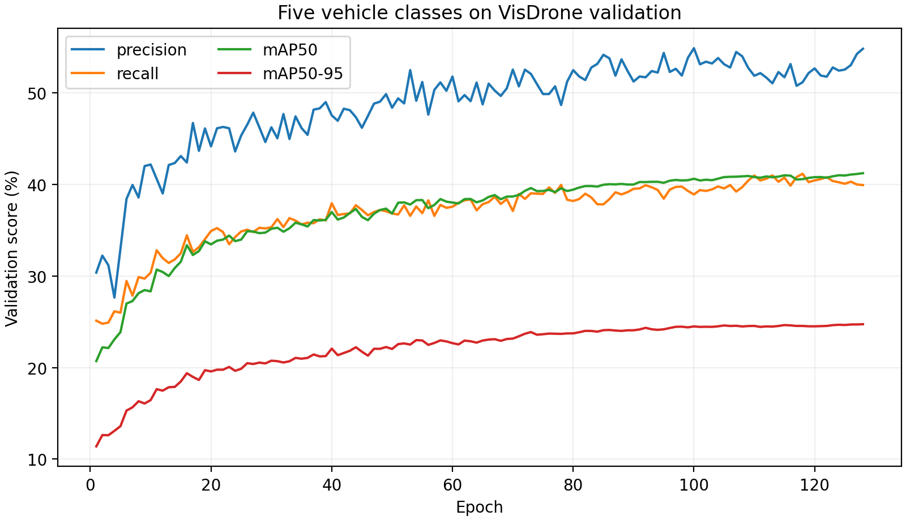

# Vehicle speed estimation from a fixed bridge camera

YOLO11n detects five vehicle classes, ByteTrack assigns IDs, and a calibrated road region converts vehicle motion to km/h. Training figures, configuration and CPU/GPU benchmarks are in report_visdrone/.

## Results

| Experiment | Result |
| --- | --- |
| YOLO11n on VisDrone-DET validation, five classes | 54.7% precision, 40.1% recall, 41.2% mAP50, 24.8% mAP50–95 |
| Motorcycle detection on the same split | 52.9% precision, 41.0% recall, 40.8% AP50 |
| YOLO11n + ByteTrack, GTX 1650 SUPER / Ryzen 3 3100 | 76.1 / 18.7 FPS on one 275-frame intersection sequence |
| GPU pipeline including video and CSV export | 30.1 FPS on the same sequence |
| Speed calculation | A synthetic trajectory covering 10 m in 0.5 s produced 72 km/h |

Training used 6,471 images and validation used 548. The 640-pixel, batch-4 run completed 128 epochs at the scheduled cutoff. The bridge demonstration uses assumed dimensions for one road region. Real speed error requires surveyed calibration and independent reference passages. BrnoCompSpeed is a candidate for that evaluation.



[Checkpoint](runs/traffic/weights/best.pt) · [Training configuration](report_visdrone/args.yaml) · [Per-class results](report_visdrone/best_validation.csv) · [Timing measurements](report_visdrone/benchmark.json)

## Run locally

Run from the repository root in the lane-det environment with Python 3.10, Ultralytics, PyTorch, OpenCV, NumPy and lap. Supply the original fixed-camera video locally.

Create the output directory with `mkdir -p outputs`. To generate a calibration still from your own clip, use the same decoder as tracking:

```bash
python -c "import cv2; from src.camera_io import read_video; cv2.imwrite('outputs/bridge_calibration_frame.jpg', next(read_video('IMG_9471.MOV'))[2])"
```

1. Export detections with the final model.

       python -m src.detector_tracker IMG_9471.MOV runs/traffic/weights/best.pt outputs/bridge_tracks.csv

   Create the outputs directory first. The CSV uses zero-based frames, recording timestamps and original-resolution pixel coordinates.

2. Calibrate using four identifiable points on the same flat road surface. Measure their coordinates in a common metric coordinate system. For a measured rectangle use (0,0), (length,0), (length,width), (0,width). Choose points around the measurement area. Use the full decoded frame in the same orientation. The GUI accepts eight numbers following --meters, in the same order as the four clicks.

       python -m src.calibrate outputs/bridge_calibration_frame.jpg outputs/calibration.json --meters X1 Y1 X2 Y2 X3 Y3 X4 Y4

3. Generate the speed overlay and per-observation CSV.

       python -m src.road_speed IMG_9471.MOV outputs/bridge_tracks.csv outputs/calibration.json outputs

   The box bottom center serves as the ground contact estimate. Estimates start after half a second inside the calibrated region. The estimator resets on gaps over 0.25 seconds and takes a five-estimate median for display. A moved camera or a different road plane needs its own calibration.

4. Evaluate with independently measured vehicle passages from this same clip. Prepare a CSV with track_id,start_s,end_s,reference_kmh. Leave the ID empty for missed passages. One reference option uses two independently measured road marks and manually timed crossings, with reference_kmh = 3.6 * distance_m / elapsed_s.

       python -m src.evaluate_speed outputs/speeds.csv reference_passages.csv

   Compare raw-window and smoothed speeds, record matched passage coverage, and inspect missed motorcycles and ID switches. VisDrone detection scores do not measure speed accuracy.

## Data and methods

- [VisDrone](https://github.com/VisDrone/VisDrone-Dataset) supplied aerial vehicle annotations for detector training and validation.
- [ByteTrack](https://github.com/ifzhang/ByteTrack) associates detections between consecutive frames.
- [BrnoCompSpeed](https://github.com/JakubSochor/BrnoCompSpeed) provides fixed-camera speed reference data for future evaluation.

The offline report archive also contains footage, overlays, CSV exports and a Word report starter. Raw footage and dataset archives are excluded from Git.
